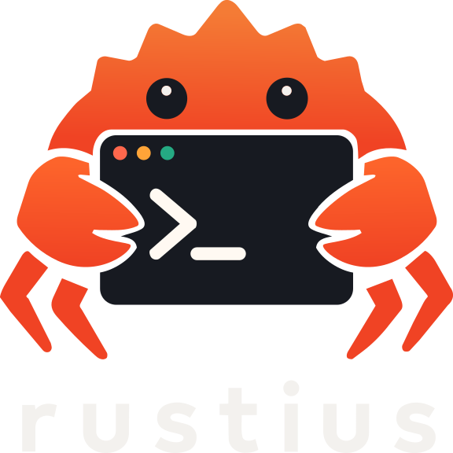

<p align="center">
  
</p>

<h1 align="center">Rustius</h1>

<p align="center">
  <strong>Fast, minimal, and secure desktop client for SSH, SFTP, and RDP.</strong>
</p>

<p align="center">
  <a href="https://rustius.app/"></a>
  <a href="https://github.com/jlmanohar/rustius/releases"></a>
  <a href="https://tauri.app/"></a>
  <a href="https://svelte.dev/"></a>
  <a href="https://www.rust-lang.org/"></a>
  <a href="LICENSE"></a>
</p>

---

Rustius is a lightweight, cross-platform remote management client built for developers and system administrators who want a fast, clean workspace without the memory bloat of Electron or cluttered legacy interfaces.

Powered by a native **Rust** backend and an **OS Webview** frontend with **Svelte 5**, Rustius ships as a single compact binary with instant startup, tabbed workflows, and first-class portability.

---

## Key Features

### 🖥️ Modern Terminal & SSH
- **Full Terminal Emulation**: Built with `@xterm/xterm` with web link detection, search, and native resize reflow.
- **Pure-Rust SSH Engine**: Powered by `russh` with background connection keep-alive, session recovery, and fast crypto.
- **Local Shell Support**: Spawn local PowerShell, Command Prompt, or bash instances alongside remote SSH sessions via `portable-pty`.
- **In-Session Documentation**: Slide-out Markdown notes drawer to keep connection runbooks, checklists, and one-click copyable command snippets right beside active sessions.
- **Tab State Persistence**: Terminal scrollback buffers and geometry are preserved across tab switches.

### 📂 Dual-Mode SFTP File Transfer
- **In-Terminal Side Navigator**: Toggle a live SFTP sidebar directly inside active SSH sessions (MobaXterm style).
- **Directory Follow / Sync**: Automatically tracks your active shell directory as you navigate in the terminal (`cd`), keeping remote files in sync with your command line.
- **Dedicated Dual-Pane Manager**: Full-screen dual-pane view for bulk local-to-remote and remote-to-local file transfers.
- **File Operations**: Upload, download, create folders, rename, delete, and download directly to your system Downloads folder.

### 🪟 Remote Desktop (RDP)
- **Hardware-Accelerated Remote Desktop**: Powered by `FreeRDP` with Direct3D / H.264 / 60+ FPS graphics.
- **Dynamic Resolution & Smart Sizing**: Presets for Fit Viewport, 1080p, 1440p, 4K, and Ultrawide resolutions.
- **Desktop DPI Scaling**: Custom client-side DPI scaling (100%–300%) with automatic high-DPI calculation for razor-sharp text and icons on 2K/4K displays.
- **Docked or Detached Mode**: Keep sessions seamlessly embedded inside tabs or pop them out into detached native windows for multi-monitor setups.

### 🔐 Secure Credential Management & Profiles
- **Reusable Credential Profiles**: Define admin or service credentials once and link them across multiple SSH, SFTP, or RDP hosts.
- **OS Keyring Integration**: Stores passwords, private key passphrases, and secrets in your platform's native secure store (Windows Credential Manager, macOS Keychain, Linux Secret Service).
- **Encrypted Local Vault**: Optional encrypted storage fallback using Argon2id key derivation and ChaCha20-Poly1305 / AES-GCM encryption.
- **Multiple Auth Methods**: Supports SSH passwords, private key files (with or without passphrase), and interactive terminal authentication.

### 🔄 1-Click Migration & Importers
- **MobaXterm Import**: Import server hierarchies and session trees directly from `.mxtsessions` files.
- **mRemoteNG Import**: Import encrypted or plaintext connection trees directly from `confCons.xml`.

### 🧳 Portable Mode (Zero-Installation)
Rustius follows VS Code-style portable data resolution:
- Place a `data/` or `rustius-data/` folder next to `rustius.exe` (or create a `.portable` marker file), and the application runs in **Portable Mode**—storing all sessions, configurations, and state entirely on the portable drive.
- Without a portable folder, Rustius neatly saves settings in your standard OS user profile directory (`%APPDATA%\rustius` on Windows, `~/.config/rustius` on Linux, `~/Library/Application Support/rustius` on macOS).

### 🎨 Clean, Minimalist Interface
- **Geist Design Language**: High-contrast, typography-driven dark interface free of unnecessary visual noise.
- **Frameless Window**: Custom native window controls with fluid window dragging and smooth minimize/maximize behaviors.
- **Organized Workspace**: Group connections into hierarchical folders with custom environment tags (Production, Staging, Development).

---

## Architecture

Rustius is structured as a Rust workspace with clean separation between protocol crates and the desktop application:

```
rustius/
├── crates/
│   ├── rustius-core       # Config storage, connection models, vault & session importers
│   ├── rustius-ssh        # SSH sessions (russh) & SFTP operations (russh-sftp)
│   ├── rustius-rdp        # RDP session orchestration and FreeRDP embedding
│   └── rustius-terminal   # Cross-platform local PTY management (portable-pty)
├── src-tauri/             # Tauri v2 application shell, commands, and window orchestration
└── src/                   # Svelte 5 frontend (SvelteKit SPA, xterm.js, UI components)
```

---

## Prerequisites

To build Rustius from source, make sure you have:

- **Node.js** (v20 or later) & **npm**
- **Rust** (stable toolchain, 1.77+ recommended)
- **Platform Dependencies**:
  - **Windows**: Microsoft Visual Studio C++ Build Tools & WebView2 (installed by default on Windows 10/11)
  - **Linux**: `libwebkit2gtk-4.1-dev`, `build-essential`, `curl`, `wget`, `file`, `libssl-dev`, `libayatana-appindicator3-dev`, `librsvg2-dev`, `patchelf`
  - **macOS**: Xcode Command Line Tools

---

## Building from Source

1. **Clone the repository:**
   ```bash
   git clone https://github.com/jlmanohar/rustius.git
   cd rustius
   ```

2. **Install frontend dependencies:**
   ```bash
   npm install
   ```

3. **Run in development mode:**
   ```bash
   cargo tauri dev
   ```
   *This starts the Vite dev server and launches the Tauri desktop application with hot-reloading.*

4. **Build the production release:**
   ```bash
   # Package the desktop client and installers
   cargo tauri build
   ```
   *Compiles an optimized native binary and packages installer bundles (MSI / NSIS on Windows) into `target/release/bundle/`.*

> [!NOTE]
> Always use `cargo tauri build` rather than raw `cargo build` to ensure the compiled frontend assets are embedded directly into the final standalone executable.

---

## Configuration & Storage

Rustius stores your connections, folders, and preferences in a clean `config.toml` file.

| Mode | Location |
|---|---|
| **Portable** | `<exe-directory>/data/config.toml` or `<exe-directory>/rustius-data/config.toml` |
| **Windows** | `%APPDATA%\rustius\config.toml` |
| **macOS** | `~/Library/Application Support/rustius/config.toml` |
| **Linux** | `~/.config/rustius/config.toml` or `$XDG_CONFIG_HOME/rustius/config.toml` |

Sensitive credentials (passwords, private key passphrases) are never stored in plaintext inside `config.toml`; they are safely delegated to your system's OS Credential Store.

---

## License

This project's source code is licensed under the [MIT License](LICENSE).

The **Rustius** name, logos, mascots, and associated brand assets are reserved and protected under copyright and trademark law. See [LICENSE](LICENSE) for details.
