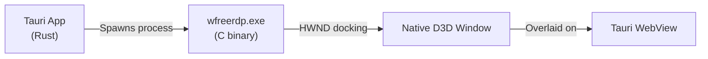
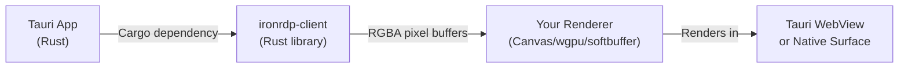
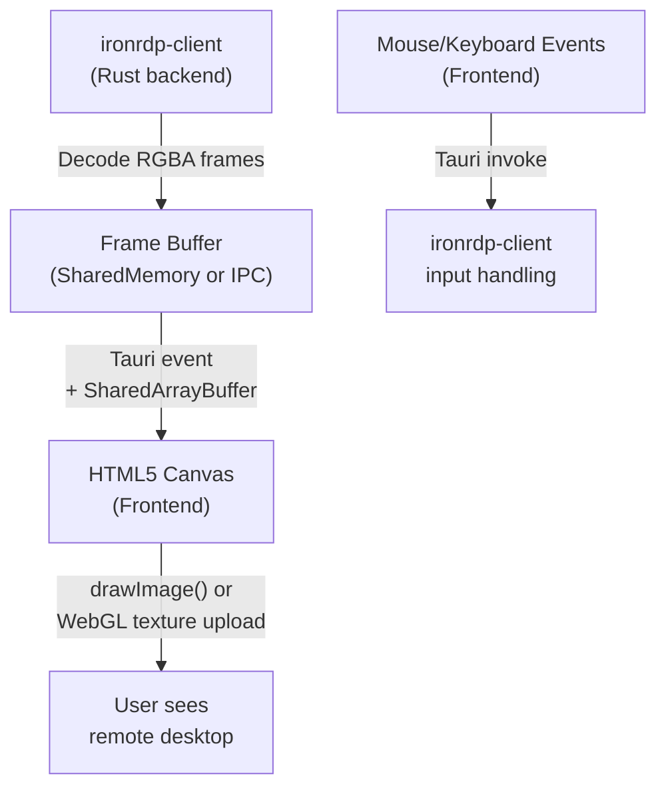
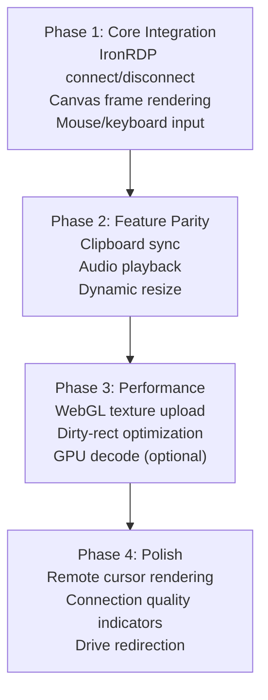

# IronRDP Deep Research — Replacing FreeRDP in Rustius

## Executive Summary

> [!IMPORTANT]
> **IronRDP does NOT ship built-in GPU-accelerated video decode.** Its reference viewer (`ironrdp-viewer`) uses **software rendering** via `softbuffer` + `winit`. However, IronRDP's modular architecture makes it *possible* to wire in GPU decode — you just have to build that layer yourself. This is both its greatest strength and its biggest integration cost.

**Bottom line:** IronRDP can replace FreeRDP and deliver a native-feeling, cross-platform RDP experience — but achieving GPU-accelerated H.264 decode and smooth 60fps display requires **significant custom integration work** that IronRDP intentionally leaves to the embedder.

---

## 1. Architecture Comparison

### Current Rustius Approach: FreeRDP Child Process



**What you have today:**
- Spawn `wfreerdp.exe` / `xfreerdp` as a **child process**
- Hunt for its HWND via `EnumWindows`, dock it over the Tauri webview
- FreeRDP handles **everything**: TLS, NLA, H.264 decode, D3D rendering, clipboard, audio
- ~1000 lines of Win32 window docking gymnastics in [freerdp.rs](file:///c:/Users/jlmanohar/Documents/Projects/rustius/crates/rustius-rdp/src/freerdp.rs)

**Pain points:**
- Windows-only HWND docking (Linux/macOS have completely different embedding)
- FreeRDP binary must be shipped alongside the app
- No control over rendering pipeline
- Z-order/focus/minimize battles between webview and FreeRDP window
- Cross-compilation nightmare for CI/CD

### IronRDP Approach: Pure Rust Library



**What IronRDP gives you:**
- Pure Rust, direct Cargo dependency — no child process, no FFI
- Async/Tokio-native, fits perfectly into Tauri's backend
- Emits **decoded pixel buffers** (`RdpOutputEvent`) via channels
- **You** decide how to render those pixels

---

## 2. GPU Acceleration: The Full Truth

### 2.1 What IronRDP Does Internally

| Graphics Codec | IronRDP Support | Decode Method |
|:---|:---|:---|
| Raw Bitmap / RLE | ✅ Full | Software (CPU) |
| RemoteFX (RFX) | ✅ Full | Software DWT (CPU) |
| ClearCodec | ✅ Full | Software (CPU) |
| ZGFX Compression | ✅ Full | Software (CPU) |
| **H.264 AVC420** | ✅ Via `openh264` feature | **Software decode (CPU)** |
| **H.264 AVC444** | ✅ Via `openh264` feature | **Software decode (CPU)** |

> [!WARNING]
> IronRDP's H.264 support uses **OpenH264** (Cisco's software codec). This is pure CPU decode — no GPU acceleration whatsoever. At 1080p+ resolutions, this can spike CPU usage significantly.

### 2.2 The GPU Decode Gap

IronRDP **intentionally** does not include hardware-accelerated decode. The `ironrdp-viewer` reference app uses:
- **`softbuffer`** — CPU-blitted pixel arrays to OS window compositor
- **`winit`** — Cross-platform windowing
- No GPU pipeline, no shaders, no texture upload

This is by design: IronRDP is a **protocol library**, not a complete client. GPU decode is the embedder's responsibility.

### 2.3 How We Could Add GPU Decode

To achieve smooth, GPU-accelerated display in Rustius, we would need to build a rendering pipeline:

#### Option A: Vulkan Video via `gpu-video` (Most Modern)
```
IronRDP → H.264 NAL units → gpu-video (Vulkan Video) → wgpu::Texture → render
```
- **Pros:** Zero-copy GPU decode, frames never leave VRAM, cross-platform (Win/Linux/macOS with MoltenVK)
- **Cons:** Requires Vulkan 1.3+ and Video extensions (NVIDIA RTX, AMD RDNA2+, Intel Arc), no older GPU support
- **Maturity:** Emerging — `gpu-video` crate is actively developed but young

#### Option B: Platform-Specific Hardware Decoders
```
IronRDP → H.264 bitstream → Platform API → GPU texture → render
```

| Platform | API | Rust Crate / Approach |
|:---|:---|:---|
| Windows | MediaFoundation MFT | `windows` crate + unsafe FFI |
| macOS | VideoToolbox | `core-video` / `core-media` FFI |
| Linux | VA-API | `cros-libva` / `libva` bindings |

- **Pros:** Maximum GPU compatibility, OS-native, battle-tested
- **Cons:** Three separate implementations to maintain, significant unsafe FFI

#### Option C: FFmpeg Bindings (Pragmatic Fallback)
```
IronRDP → H.264 bitstream → ffmpeg-next → Hardware frame → wgpu import
```
- **Pros:** FFmpeg abstracts all platform decode APIs internally
- **Cons:** C dependency (defeats pure-Rust goal), complex frame import to wgpu

#### Option D: Software Decode + GPU Texture Upload (Simplest)
```
IronRDP → OpenH264 (CPU decode) → RGBA buffer → wgpu::Texture upload → GPU render
```
- **Pros:** Works everywhere immediately, simplest to implement
- **Cons:** CPU-bound decode, but GPU compositing/scaling is still hardware-accelerated
- **Reality:** This is what most Electron-based RDP viewers do, and it's *good enough* for 1080p@30fps

> [!TIP]
> **Recommended starting point:** Option D (software decode + GPU texture upload). It gets you 90% of the way with 10% of the effort. Upgrade to Option A or B later for 4K/high-refresh scenarios.

---

## 3. Feature Completeness: IronRDP vs FreeRDP

| Feature | FreeRDP | IronRDP | Notes |
|:---|:---:|:---:|:---|
| **TLS 1.2/1.3** | ✅ | ✅ | IronRDP enforces TLS, no legacy RC4 |
| **NLA / CredSSP** | ✅ | ✅ | NTLM + Kerberos supported |
| **NTLM Auth** | ✅ | ✅ | |
| **Kerberos Auth** | ✅ | ✅ | |
| **Bitmap / RLE** | ✅ | ✅ | |
| **RemoteFX** | ✅ | ✅ | Software DWT |
| **EGFX Pipeline** | ✅ | ✅ | ClearCodec, RFX, AVC |
| **H.264/AVC** | ✅ (GPU) | ⚠️ (CPU only) | OpenH264 software decode |
| **Clipboard (text)** | ✅ | ✅ | `ironrdp-cliprdr` |
| **Clipboard (files)** | ✅ | ✅ | Delayed rendering pattern |
| **Audio Output** | ✅ | ✅ | `ironrdp-rdpsnd` (needs audio backend) |
| **Audio Input (Mic)** | ✅ | ✅ | `ironrdp-rdpeai` (needs audio backend) |
| **Drive Redirection** | ✅ | ⚠️ Partial | `ironrdp-rdpdr` — protocol layer exists |
| **Dynamic Resolution** | ✅ | ✅ | Display control channel |
| **Multi-Monitor** | ✅ | ✅ | Capability negotiation |
| **Smart Card** | ✅ | ❌ | Not implemented |
| **Printer Redirect** | ✅ | ❌ | Not implemented |
| **USB Redirect** | ✅ | ❌ | Not implemented |
| **RemoteApp** | ✅ | ❌ | Not implemented |
| **Gateway/Proxy** | ✅ | ✅ | Devolutions Gateway (WebSocket) |
| **WASM/Browser** | ❌ | ✅ | First-class WebAssembly target |

> [!NOTE]
> For Rustius's core use case (connect to Windows machines, see the desktop, type, click, copy/paste, hear audio), **IronRDP covers all the essentials**. The missing features (smart card, printer, USB, RemoteApp) are enterprise-specific and unlikely to be needed by most users.

---

## 4. Cross-Platform Story

### 4.1 What Works Cross-Platform Today

| Capability | Windows | macOS | Linux |
|:---|:---:|:---:|:---:|
| RDP Connection | ✅ | ✅ | ✅ |
| TLS/NLA/CredSSP | ✅ | ✅ | ✅ |
| Graphics Decode | ✅ | ✅ | ✅ |
| Clipboard | ✅ | ✅ | ✅ |
| Audio (with backend) | ✅ | ✅ | ✅ |
| Keyboard/Mouse Input | ✅ | ✅ | ✅ |
| Cargo Cross-Compile | ✅ | ✅ | ✅ |

### 4.2 Current Rustius vs IronRDP Cross-Platform

| | FreeRDP (Current) | IronRDP (Proposed) |
|:---|:---|:---|
| **Windows** | ✅ Works (HWND docking) | ✅ Would work (Canvas or wgpu) |
| **macOS** | ❌ No NSView docking code | ✅ Would work (same renderer) |
| **Linux** | ❌ No X11/Wayland docking | ✅ Would work (same renderer) |
| **Build Complexity** | Ship separate C binary per OS | Single `cargo build` |
| **CI/CD** | Painful cross-compilation | Standard Rust toolchain |

> [!IMPORTANT]
> IronRDP solves the **biggest pain point** of the current FreeRDP approach: true cross-platform support from a single codebase, with no platform-specific window docking hacks.

---

## 5. Rendering in Tauri: Making It Feel Native

### 5.1 Strategy: Canvas-Based Rendering (Recommended)

The most practical approach for Tauri + IronRDP:



**Why Canvas:**
- Works identically on Windows, macOS, Linux
- WebGL2 can do GPU-accelerated texture upload and scaling
- No native window docking gymnastics
- Perfectly integrated into Tauri's webview — no Z-order battles
- Responsive resize, smooth scrolling, native-feeling tab switching

**Performance at 1080p@30fps:**
- ~6MB/s raw RGBA data (1920×1080×4 bytes × 30fps)
- Manageable via SharedArrayBuffer or base64 chunks
- WebGL texture upload is GPU-accelerated
- Dirty-rectangle optimization reduces actual data transferred

### 5.2 Strategy: wgpu Native Surface (Maximum Performance)

For absolute maximum performance, render to a native surface alongside the webview:

```
ironrdp-client → RGBA buffer → wgpu::Device → wgpu::Surface → Native compositor
```

- Bypasses webview entirely for the RDP viewport
- True GPU-composited rendering pipeline
- More complex Tauri integration (native window overlay)
- Essentially rebuilding the HWND docking problem, but with a controlled renderer

### 5.3 "Native Feel" Checklist

| Aspect | How to Achieve |
|:---|:---|
| **Smooth scrolling** | Canvas with requestAnimationFrame, dirty-rect updates |
| **Responsive resize** | IronRDP display control channel + dynamic resolution |
| **Low input latency** | Direct `invoke()` for mouse/key → minimal IPC overhead |
| **Cursor sync** | Render remote cursor position on canvas |
| **Clipboard sync** | `ironrdp-cliprdr` + Tauri clipboard plugin |
| **Audio playback** | `ironrdp-rdpsnd` + `rodio` or `cpal` in Rust backend |
| **Tab switching** | Instant — just swap which frame buffer renders to canvas |

---

## 6. Integration Architecture for Rustius

### 6.1 Proposed Crate Structure

```
crates/
├── rustius-rdp/           # Replace FreeRDP → IronRDP
│   └── src/
│       ├── lib.rs
│       ├── session.rs     # IronRDP session lifecycle (connect/disconnect)
│       ├── renderer.rs    # Frame buffer management, dirty-rect tracking
│       ├── input.rs       # Mouse/keyboard event translation
│       ├── clipboard.rs   # Clipboard bridge (ironrdp-cliprdr)
│       └── audio.rs       # Audio playback bridge (ironrdp-rdpsnd + rodio)
```

### 6.2 Key Dependencies

```toml
[dependencies]
ironrdp-client = "0.x"          # Core RDP client engine
ironrdp-connector = "0.x"       # Connection sequencing
ironrdp-session = "0.x"         # Session state machine
ironrdp-graphics = "0.x"        # Graphics codec processing
ironrdp-cliprdr = "0.x"         # Clipboard redirection
ironrdp-rdpsnd = "0.x"          # Audio output
ironrdp-tokio = "0.x"           # Async transport
openh264 = "0.x"                # H.264 software decode (feature-gated)
rodio = "0.x"                   # Cross-platform audio playback
```

### 6.3 Frontend Integration

Replace `RdpView.svelte` (currently a native window overlay) with a canvas-based renderer:

```svelte
<!-- New RdpView.svelte (simplified concept) -->
<canvas bind:this={canvas} class="rdp-viewport" 
  onmousemove={handleMouseMove}
  onmousedown={handleMouseDown}
  onkeydown={handleKeyDown}
/>
```

Frame updates flow via Tauri events:
```typescript
listen('rdp-frame-update', (event) => {
  const { x, y, width, height, pixels } = event.payload;
  ctx.putImageData(new ImageData(pixels, width, height), x, y);
});
```

---

## 7. Risk Assessment

| Risk | Severity | Mitigation |
|:---|:---:|:---|
| **OpenH264 CPU bottleneck at 4K** | 🟡 Medium | Start with 1080p; add GPU decode path later |
| **Frame transfer overhead (IPC)** | 🟡 Medium | Dirty-rectangle updates, not full frames |
| **Missing enterprise features** | 🟢 Low | Smart card/printer/USB rarely needed |
| **IronRDP API stability** | 🟡 Medium | Pin to specific version, track releases |
| **Audio integration effort** | 🟡 Medium | `ironrdp-rdpsnd` + `rodio` is well-documented |
| **Canvas input latency** | 🟢 Low | Direct invoke(), sub-millisecond IPC |
| **Cross-platform build issues** | 🟢 Low | Pure Rust, standard toolchain |

---

## 8. What's Possible vs What's Not

### ✅ Definitely Possible
- **Full cross-platform RDP client** (Windows, macOS, Linux) from a single codebase
- **Smooth 1080p display** at 30fps with software decode + canvas rendering
- **Native-feeling input** with low-latency mouse/keyboard forwarding
- **Clipboard sync** (text + files) between local and remote
- **Audio playback** of remote session sounds
- **Dynamic resolution** that follows window resize
- **Tab-based session management** without HWND docking hacks
- **Eliminate FreeRDP binary dependency** entirely

### ⚠️ Possible with Extra Work
- **GPU-accelerated H.264 decode** — requires building a custom decode pipeline (Vulkan Video, platform APIs, or FFmpeg)
- **60fps smooth display** — achievable with WebGL texture upload + dirty-rect optimization
- **Drive/folder redirection** — `ironrdp-rdpdr` has protocol support, needs client-side filesystem integration
- **Multi-monitor support** — IronRDP negotiates it, but rendering to multiple surfaces needs custom work

### ❌ Not Currently Possible
- **Smart card redirection** — not implemented in IronRDP
- **Printer redirection** — not implemented
- **USB device redirection** — not implemented
- **RemoteApp / seamless windows** — not implemented
- **Hardware-accelerated D3D rendering** (like FreeRDP's native window) — you'd be rendering to Canvas/WebGL instead

---

## 9. Recommendation

> [!TIP]
> **Migrate to IronRDP.** The cross-platform gains and architectural cleanliness far outweigh the loss of FreeRDP's native D3D rendering. Start with software decode + Canvas rendering (works everywhere, immediately), then add GPU decode as a performance optimization.

### Migration Path



**Phase 1** alone would give you a working cross-platform RDP client that runs identically on Windows, macOS, and Linux — something the current FreeRDP approach cannot do.
